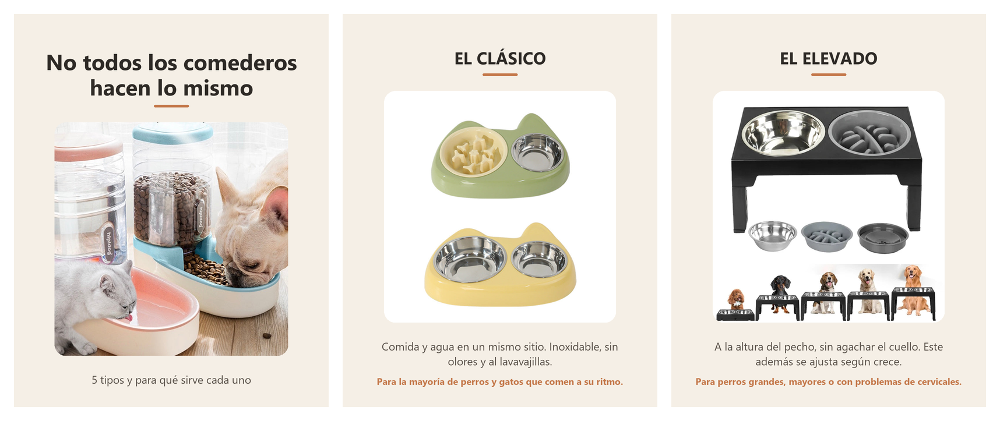

# Petsforyou · AI & automation samples

**English** · [Español](#español)

Real code from [Petsforyou](https://www.petsforyou.es), an online pet store in Spain run by María Luz Mozo Weisz. This repository is a cleaned-up copy of two pieces that run in production, published as a portfolio sample. Keys, account IDs and private data were removed; the store-specific values are now configuration.

> **How it was built:** with AI-assisted development (Claude Code). María defined what each piece had to do, set the business rules, reviewed the results and tested them on the live store; the code was written with Claude.

## 1. AI shopping assistant · `shopping-assistant/`

A chat on the store's website where customers describe their pet and what they need, and get real products from the catalog with price, link and delivery time. It is live on petsforyou.es (the paw button, bottom right).

**How it works**

```
Browser chat (widget.js)  ──POST /asistente──▶  Cloudflare Worker
                                                   │  Claude (tool use)
                                                   │    ├─ buscar_productos → Shopify Admin GraphQL (read-only)
                                                   │    └─ ver_producto     → full product page data
                                                   ▼
                                     reply + product cards (cheapest first)
```

- **Claude with tools:** the model never invents products. It must search the catalog first (`buscar_productos`, `ver_producto`) and can only recommend what the tools return. Up to 4 tool rounds per question.
- **Business rules in code, not only in the prompt:** results are spread from the cheapest to the dearest, leaning to affordable options (`spreadByPrice`); products named after the search come first; budgets, "show me more" (exclude already shown) and made-to-order products are handled explicitly.
- **Safety and cost control:** the API key never leaves the Worker; customer text is cleaned of Shopify search operators; CORS allow-list; daily limits per visitor and for the whole store, counted under a SHA-256 hash (no IP or conversation is stored); old counters pruned by a cron.
- **Frontend:** one self-contained script the Shopify theme loads with a single `<script>` tag. Links are only shown when they point to the store's own domain.
- **Tests:** 23 unit tests with Vitest, mocking the Anthropic and Shopify APIs and an in-memory D1.

**Stack:** TypeScript · Cloudflare Workers · D1 (SQLite) · Anthropic Messages API (tool use) · Shopify Admin GraphQL API · Vitest

```bash
cd shopping-assistant
npm ci
npm test            # 23 tests
npm run typecheck
cp wrangler.toml.example wrangler.toml   # then fill in your own values
```

## 2. Media pipeline · `.github/workflows/` + `media-pipeline/`

GitHub Actions that turn raw clips and product photos into ready-to-post social media content, triggered by hand or from a no-code tool (Make) through `repository_dispatch`. Used for the store's series episodes, reels and carousels.

| Workflow | What it does |
|---|---|
| `montar-capitulo.yml` | Downloads the clips of an episode, normalises them to vertical 1080×1920 / 30 fps, adds the title on the intro, joins them, mixes background music that ducks automatically when characters speak (side-chain compression), adds a 1.5 s ending and notifies Make through a webhook. |
| `subtitulos.yml` | Transcribes the video with Whisper (`faster-whisper`, word timestamps), splits the text into short readable blocks, writes an `.ass` subtitle file and burns it into the video. |
| `avance.yml` | Two steps for a teaser: `analizar` makes a contact sheet (one frame per second with its time) and detects silences; `cortar` cuts the chosen 5-8 s with a caption and fades. |
| `carrusel.yml` + `carrusel.py` | Builds 1080×1350 carousel slides from a JSON file: headline, accent line, product photo sized to the space the text leaves, and text. The photo can be a URL, a Pexels search or an image generated with the OpenAI Images API. |

Results are kept as run artifacts. Optionally, if the repository variable `PUBLISH_REPO` is set, they are also pushed to that public repository so social media APIs can read them by URL.



*Three slides from `media-pipeline/examples/comederos.json` (preview rendered locally; on GitHub Actions the font is DejaVu Sans).*

**Stack:** GitHub Actions · ffmpeg / ffprobe · Python · Pillow · faster-whisper · Pexels API · OpenAI Images API · Make (webhooks)

---

## Español

Código real de [Petsforyou](https://www.petsforyou.es), una tienda online de productos para mascotas en España, de María Luz Mozo Weisz. Este repositorio es una copia limpia de dos piezas que funcionan en la tienda, publicada como muestra de trabajo. Se han quitado las claves, los identificadores de cuentas y los datos privados; lo propio de la tienda ahora es configuración.

> **Cómo se ha hecho:** con desarrollo asistido por IA (Claude Code). María definió qué tenía que hacer cada pieza, puso las reglas del negocio, revisó los resultados y los probó en la tienda real; el código lo escribió Claude.

### 1. Asistente de compras con IA · `shopping-assistant/`

Un chat en la web de la tienda: el cliente cuenta qué mascota tiene y qué busca, y recibe productos reales del catálogo con precio, enlace y plazo de entrega. Está funcionando en petsforyou.es (la huella de abajo a la derecha).

- **Claude con herramientas:** el modelo no se inventa productos. Primero busca en el catálogo (`buscar_productos`, `ver_producto`) y solo recomienda lo que le devuelven. Como mucho 4 rondas de herramientas por pregunta.
- **Las reglas del negocio, en el código y no solo en el prompt:** los productos salen del más barato al más caro, con más peso a los económicos; primero los que se llaman como lo buscado; presupuesto, «enséñame más» sin repetir y productos hechos por encargo.
- **Seguridad y coste:** la clave nunca sale del Worker; se limpian los operadores de búsqueda del texto del cliente; solo responde a las webs de la tienda; límites diarios por visitante y para toda la tienda, contados con un resumen SHA-256 (no se guarda ni la IP ni la conversación).
- **Pruebas:** 23 pruebas automáticas con Vitest.

**Tecnologías:** TypeScript, Cloudflare Workers, D1, API de Anthropic (uso de herramientas), API GraphQL de Shopify, Vitest.

### 2. Montaje de vídeo e imágenes · `.github/workflows/` + `media-pipeline/`

Flujos de GitHub Actions que convierten clips y fotos de producto en piezas listas para redes. Se lanzan a mano o desde Make (`repository_dispatch`). Se usan para los capítulos de la serie de la tienda, los reels y los carruseles.

- **`montar-capitulo.yml`:** une los clips en vertical 1080×1920, pone el título, mezcla la música bajándola sola cuando hablan los personajes y avisa a Make al terminar.
- **`subtitulos.yml`:** transcribe con Whisper, parte el texto en bloques cortos e incrusta los subtítulos.
- **`avance.yml`:** hoja de fotogramas y detección de silencios para elegir el momento; después corta el avance con rótulo y fundidos.
- **`carrusel.yml` + `carrusel.py`:** diapositivas de carrusel a partir de un JSON, con foto por URL, búsqueda en Pexels o imagen generada.

**Tecnologías:** GitHub Actions, ffmpeg, Python, Pillow, faster-whisper, API de Pexels, API de imágenes de OpenAI, Make.

---

MIT License · © 2026 María Luz Mozo Weisz
